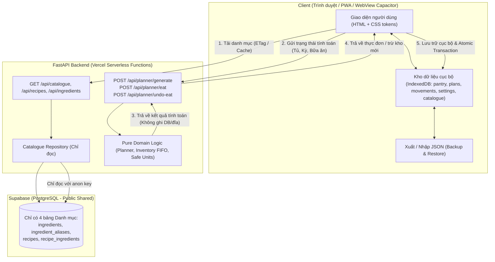

# EasyMeals — Tài liệu Kiến trúc Hệ thống (Architecture Specification)

Tài liệu này xác định kiến trúc kỹ thuật mới của **EasyMeals**: **Hệ thống dữ liệu cá nhân cục bộ (Local-first / Client-stored Personal Data) kết hợp Backend tính toán không trạng thái (Stateless Backend) và Cơ sở dữ liệu danh mục chỉ đọc (Read-only Public Catalogue)**.

---

## 1. Nguyên lý Thiết kế & Sơ đồ Luồng Dữ liệu (Data Flow)

EasyMeals hoạt động theo nguyên tắc **không lưu bất kỳ dữ liệu cá nhân nào trên máy chủ hay cơ sở dữ liệu từ xa**.



### Hai Đường Dữ Liệu Chuyên Biệt (Web vs Mobile Native)

Hệ thống thiết lập 2 đường dữ liệu tối ưu theo nền tảng:

```
+---------------------------------------------------------------------------------+
|                                 ĐƯỜNG 1: WEB APP                                |
|  - Trình duyệt Web / PWA trên máy tính và di động                               |
|  - Danh mục: Đồng bộ từ Supabase qua GET /api/catalogue (ETag / If-None-Match) |
|  - Tính toán: Chạy qua FastAPI Backend không trạng thái (hoặc fallback engine) |
|  - Dữ liệu cá nhân: Lưu trữ trong IndexedDB của trình duyệt                     |
+---------------------------------------------------------------------------------+

+---------------------------------------------------------------------------------+
|                            ĐƯỜNG 2: MOBILE APP (CAPACITOR)                      |
|  - Ứng dụng Hybrid Native Android (.apk/.aab) và iOS (.ipa)                     |
|  - HOÀN TOÀN OFFLINE: Không gọi Supabase, không gọi backend, không cần mạng    |
|  - Danh mục: Đóng gói sẵn trong file data/catalogue.json (CATALOGUE_SOURCE=bundled)
|  - Tính toán: Chạy trực tiếp trên máy bằng JavaScript Engine (engine.js)        |
|    với số học Decimal chính xác, trừ kho FIFO, hoàn tác, lập thực đơn không lặp|
|  - Dữ liệu cá nhân: Lưu trữ trong IndexedDB của WebView trên thiết bị          |
+---------------------------------------------------------------------------------+
|                         ĐƯỜNG 3: MOBILE APP THUẦN NATIVE                        |
|  - Ứng dụng Pure Native Android (Kotlin + Compose) & iOS (Swift + SwiftUI)      |
|  - TUYỆT ĐỐI KHÔNG INTERNET: Bỏ hẳn quyền android.permission.INTERNET, không ATS|
|  - Danh mục: Đóng gói bundled assets catalogue.json có checksum SHA256          |
|  - Tính toán: EasyMealsEngine viết riêng bằng Kotlin & Swift sử dụng ExactDecimal|
|    chính xác tuyệt đối, khớp 100% kết quả engine_test_cases.json                |
|  - Lưu trữ: Tệp cục bộ JSON an toàn trong sandbox của ứng dụng                  |
+---------------------------------------------------------------------------------+
```

### Bảng phân bố dữ liệu: "Dữ liệu nằm ở đâu?"

| Dữ liệu | Web App | Mobile App (Capacitor) | Vòng đời & Bản quyền | Chế độ Offline |
|---|---|---|---|---|
| **Danh mục món ăn, nguyên liệu, công thức, alias** | Supabase Postgres (Public Read) -> Cache IndexedDB | **Đóng gói sẵn trong ứng dụng** (`catalogue.json`) -> Nạp IndexedDB | Dùng chung toàn hệ thống, cập nhật khi nâng cấp app hoặc seed | **100% Offline** (Mobile không cần kết nối mạng) |
| **Kho thực phẩm / Tủ lạnh (Pantry lots)** | IndexedDB client (`pantry` store) | IndexedDB client (`pantry` store) | Thuộc sở hữu duy nhất của thiết bị | **Xem, thêm, sửa, xoá offline** |
| **Kế hoạch thực đơn (Meal plans)** | IndexedDB client (`plans` store) | IndexedDB client (`plans` store) | Thuộc sở hữu thiết bị | **Web & Mobile tạo thực đơn offline hoàn toàn** |
| **Lịch sử biến động kho (Stock movements)** | IndexedDB client (`movements` store) | IndexedDB client (`movements` store) | Thuộc sở hữu thiết bị; phục vụ audit và hoàn tác | **Web & Mobile trừ kho và hoàn tác offline hoàn toàn** |
| **Cài đặt & Lịch sử sao lưu** | IndexedDB client (`settings` store) | IndexedDB client (`settings` store) | Thuộc sở hữu thiết bị | **Hoạt động offline** |
| **Tài khoản, phiên, cookie** | **KHÔNG TỒN TẠI** | **KHÔNG TỒN TẠI** | Không có user_id, không theo dõi | Không áp dụng |


---

## 2. Hợp đồng API Không Trạng Thái (Stateless API Contracts)

Backend FastAPI hoạt động như một cỗ máy tính toán thuần tuý (pure computational engine). Server **không lưu bất kỳ dữ liệu nào vào DB, không ghi log body request chứa thông tin tủ/thực đơn của người dùng**.

### A. Danh mục dùng chung (Public Catalogue API - Read Only)

#### `GET /api/catalogue`
- **Mô tả**: Tải toàn bộ danh mục chuẩn (nguyên liệu, công thức, liên kết) kèm ETag/Version để client đồng bộ vào IndexedDB.
- **Headers**:
  - `If-None-Match: "<version-hash>"`
- **Response `200 OK`**:
  ```json
  {
    "catalogue_version": "2026.10.01",
    "updated_at": "2026-10-23T00:00:00Z",
    "ingredients": [
      {
        "id": "ing_thit_heo_ba_chi",
        "name": "Thịt heo ba chỉ",
        "normalized_name": "thit heo ba chi",
        "category": "man",
        "default_unit": "g"
      }
    ],
    "recipes": [
      {
        "id": "rec_thit_kho_tau",
        "title": "Thịt kho tàu",
        "category": "man",
        "servings": 4,
        "instructions": "1. Thái thịt vuông...",
        "ingredients": [
          { "ingredient_id": "ing_thit_heo_ba_chi", "quantity": "400", "unit": "g" }
        ]
      }
    ]
  }
  ```
- **Response `304 Not Modified`**: Khi ETag trùng khớp.

---

### B. Tính toán Lập thực đơn (Stateless Planner API)

#### `POST /api/planner/generate`
- **Mô tả**: Nhận danh sách nguyên liệu hiện có trong tủ và cấu hình số ngày, tính toán kế hoạch thực đơn và danh sách cần mua thiếu hụt.
- **Giới hạn đầu vào**: Body $\le 256$ KB; `pantry` $\le 500$ lots; `days` $\in [1, 31]$.
- **Request mẫu**:
  ```json
  {
    "pantry": [
      {
        "id": "lot-1",
        "ingredient_id": "ing_thit_heo_ba_chi",
        "initial_quantity": "500",
        "remaining_quantity": "500",
        "unit": "g",
        "purchased_at": "2026-10-23T08:00:00Z"
      }
    ],
    "start_date": "2026-10-24",
    "days": 3,
    "options": {
      "include_shopping_list": true
    }
  }
  ```
- **Response mẫu `200 OK`**:
  ```json
  {
    "period_id": "gen_20261024_3d",
    "start_date": "2026-10-24",
    "end_date": "2026-10-26",
    "meals": [
      {
        "id": "meal_20261024_lunch",
        "date": "2026-10-24",
        "meal_type": "lunch",
        "dishes": [
          {
            "recipe_id": "rec_thit_kho_tau",
            "title": "Thịt kho tàu",
            "category": "man",
            "servings": 4,
            "ingredients": [
              { "ingredient_id": "ing_thit_heo_ba_chi", "name": "Thịt heo ba chỉ", "quantity": "400", "unit": "g" }
            ]
          }
        ]
      }
    ],
    "shopping_list": []
  }
  ```

---

### C. Tính toán Trừ kho & Hoàn tác (Stateless Stock Deduction & Undo API)

#### `POST /api/planner/eat`
- **Mô tả**: Nhận trạng thái tủ lạnh hiện tại và chi tiết bữa ăn; tính toán trừ kho theo nguyên tắc FIFO (First In First Out) và chuyển đổi đơn vị an toàn (`app/domain/inventory.py`).
- **Request mẫu**:
  ```json
  {
    "pantry": [
      {
        "id": "lot-1",
        "ingredient_id": "ing_thit_heo_ba_chi",
        "initial_quantity": "500",
        "remaining_quantity": "500",
        "unit": "g"
      }
    ],
    "meal": {
      "id": "meal_20261024_lunch",
      "date": "2026-10-24",
      "dishes": [
        {
          "recipe_id": "rec_thit_kho_tau",
          "ingredients": [
            { "ingredient_id": "ing_thit_heo_ba_chi", "quantity": "400", "unit": "g" }
          ]
        }
      ]
    },
    "idempotency_key": "eat_meal_20261024_lunch_attempt1"
  }
  ```
- **Response mẫu `200 OK`**:
  ```json
  {
    "success": true,
    "pantry": [
      {
        "id": "lot-1",
        "ingredient_id": "ing_thit_heo_ba_chi",
        "initial_quantity": "500",
        "remaining_quantity": "100",
        "unit": "g"
      }
    ],
    "movements": [
      {
        "id": "mov_uuid",
        "lot_id": "lot-1",
        "ingredient_id": "ing_thit_heo_ba_chi",
        "meal_id": "meal_20261024_lunch",
        "quantity_delta": "-400",
        "unit": "g",
        "reason": "meal_consumed",
        "created_at": "2026-10-24T12:00:00Z"
      }
    ]
  }
  ```

#### `POST /api/planner/undo-eat`
- **Mô tả**: Đảo ngược các biến động kho (`movements`) tương ứng của bữa ăn đã ghi nhận nhầm, cộng hoàn lại số lượng chính xác vào các lot ban đầu.
- **Request mẫu**:
  ```json
  {
    "pantry": [
      {
        "id": "lot-1",
        "ingredient_id": "ing_thit_heo_ba_chi",
        "initial_quantity": "500",
        "remaining_quantity": "100",
        "unit": "g"
      }
    ],
    "movements": [
      {
        "lot_id": "lot-1",
        "ingredient_id": "ing_thit_heo_ba_chi",
        "quantity_delta": "-400",
        "unit": "g"
      }
    ]
  }
  ```
- **Response mẫu `200 OK`**:
  ```json
  {
    "success": true,
    "pantry": [
      {
        "id": "lot-1",
        "ingredient_id": "ing_thit_heo_ba_chi",
        "initial_quantity": "500",
        "remaining_quantity": "500",
        "unit": "g"
      }
    ],
    "reversal_movements": [
      {
        "id": "mov_rev_uuid",
        "lot_id": "lot-1",
        "ingredient_id": "ing_thit_heo_ba_chi",
        "quantity_delta": "400",
        "unit": "g",
        "reason": "undo_meal_consumed"
      }
    ]
  }
  ```

---

## 3. Cấu trúc IndexedDB & Quản lý Trạng thái Cục bộ

Tên cơ sở dữ liệu: `easymeals_local_db`
Phiên bản khởi tạo: `version = 1`

### Object Stores
1. `pantry` (Kho nguyên liệu):
   - Key: `id` (UUID chuỗi).
   - Indexes: `by_ingredient_id`, `by_purchased_at`.
   - Fields: `id`, `ingredient_id`, `ingredient_name`, `initial_quantity` (string), `remaining_quantity` (string), `unit`, `purchased_at`, `created_at`.
2. `plans` (Kế hoạch thực đơn):
   - Key: `id` (UUID chuỗi).
   - Indexes: `by_start_date`, `by_date`.
   - Fields: `id`, `start_date`, `end_date`, `meals` (mảng chứa `eaten_at`, `dishes` với snapshot công thức).
3. `movements` (Lịch sử biến động kho):
   - Key: `id` (UUID chuỗi).
   - Indexes: `by_lot_id`, `by_meal_id`, `by_created_at`.
   - Fields: `id`, `lot_id`, `ingredient_id`, `meal_id`, `quantity_delta` (string), `unit`, `reason`, `created_at`.
4. `catalogue` (Bản sao danh mục dùng chung):
   - Key: `key` (chuỗi: `"meta"`, `"ingredients"`, `"recipes"`).
5. `settings` (Cài đặt ứng dụng):
   - Key: `key` (ví dụ: `"last_backup_at"`, `"theme"`, `"catalogue_version"`).

### Chiến lược Nâng cấp Phiên bản Schema IndexedDB
- Mọi hàm nâng cấp schema đều được cài đặt trong sự kiện `onupgradeneeded` tuần tự theo số phiên bản (`oldVersion < 2`, `oldVersion < 3`,...).
- Dữ liệu luôn giữ tính tương thích xuôi và tương thích ngược.

---

## 4. Định dạng Tệp Sao lưu & Phục hồi (Backup & Restore Format)

Định dạng file xuất ra là tệp JSON với cấu trúc chuẩn:
```json
{
  "schema_version": 1,
  "app": "EasyMeals",
  "exported_at": "2026-10-23T20:30:00Z",
  "metadata": {
    "total_lots": 12,
    "total_plans": 2,
    "total_movements": 8
  },
  "data": {
    "pantry": [ ... ],
    "plans": [ ... ],
    "movements": [ ... ],
    "settings": { ... }
  }
}
```

### Quy tắc Nhập Tệp (Strict Import Rules):
1. **Kiểm tra Schema Chặt Chẽ**: Kiểm tra cấu trúc `schema_version == 1`, kiểu dữ liệu của từng mảng, giới hạn kích thước file ($\le 10$ MB), giới hạn số bản ghi ($\le 5000$ lots, $\le 500$ plans).
2. **Từ chối dữ liệu độc hại / XSS**: Tất cả chuỗi văn bản khi nạp vào DOM đều được hiển thị qua `textContent` hoặc DOM API an toàn, không bao giờ dùng `innerHTML` trực tiếp từ dữ liệu nhập.
3. **Xác nhận Người dùng (Modal 2 lựa chọn)**:
   - **Ghi đè hoàn toàn (Replace)**: Xoá toàn bộ dữ liệu hiện tại trong IndexedDB và nạp dữ liệu từ file.
   - **Hợp nhất (Merge)**: Bổ sung các bản ghi chưa có (dựa trên UUID), bảo toàn các dữ liệu hiện có trên máy.

---

## 5. Mô hình Đe dọa Mới & Phòng thủ Chiều sâu (Threat Model)

Khi loại bỏ dữ liệu người dùng khỏi máy chủ, mô hình rủi ro thay đổi căn bản:

| Rủi ro mới | Mức độ | Biện pháp Phòng vệ |
|---|---|---|
| **Lạm dụng CPU / DoS qua API tính toán** | Trung bình | Pydantic `extra="forbid"`, giới hạn payload $\le 256$ KB, giới hạn `days` từ $1$ đến $7$ (`PLAN_MIN_DAYS=1`, `PLAN_MAX_DAYS=7`), giới hạn số `pantry` lots $\le 500$. Khuyến nghị bật Cloudflare/Vercel WAF Rate Limit 60 req/min/IP. |
| **XSS đánh cắp / giả mạo dữ liệu trong IndexedDB** | Cao | Cấu hình CSP nghiêm ngặt: `script-src 'self'`, không `unsafe-inline`, không `unsafe-eval`. Không render dữ liệu động bằng `innerHTML`. |
| **Tệp JSON độc hại khi Nhập (Malicious JSON Import)** | Cao | Bộ thẩm định Schema JS nghiêm ngặt (Validate Types, Enums, Max Lengths, Numerical Formats). Từ chối ngay nếu có cấu trúc lạ hoặc trường bất thường. |
| **Mất dữ liệu do trình duyệt dọn dẹp cache** | Cao | Kích hoạt `navigator.storage.persist()`. Hiển thị banner cảnh báo và nhắc nhở xuất file JSON sao lưu định kỳ trên trang `/settings`. |
| **Trừ kho hai lần do bấm đúp hoặc mở 2 tab song song** | Trung bình | Sử dụng Transaction nguyên tử của IndexedDB ở chế độ `readwrite`: kiểm tra `meal.eaten_at` ngay bên trong transaction trước khi commit ghi nhận trừ kho. |
| **Lộ khoá quản trị `service_role`** | Rất cao | Khoá `service_role` bị cấm hoàn toàn trong code máy chủ runtime và client. Server runtime sẽ từ chối khởi động (`sys.exit(1)`) nếu phát hiện `SUPABASE_SERVICE_ROLE_KEY` trong môi trường. |

---

## 6. Kiến trúc Đồng bộ Đa Nền tảng & Điểm Khác biệt Cố ý (Cross-Platform Architecture)

Nhằm đảm bảo trải nghiệm thống nhất giữa Web (FastAPI/Jinja2), Android (Jetpack Compose) và iOS (SwiftUI), hệ thống tuân theo các nguyên tắc đồng bộ sau:

### 6.1 Nguồn Chuẩn Duy nhất (Single Source of Truth)
- **Design Tokens**: `design-tokens/tokens.json` định nghĩa 5 bảng màu (`green`, `earth_orange`, `ocean_blue`, `plum_purple`, `peach_pink`) cho 2 chế độ Sáng / Tối, chuẩn hoá độ tương phản WCAG AA ($\ge 4.5:1$ cho văn bản thường), khoảng cách (spacing), bán kính góc bo (radii), và phông chữ tiêu đề **Fraunces** kết hợp phông hệ thống.
- **Nhãn Giao diện**: `design-tokens/labels.json` chuẩn hoá tiếng Việt cho toàn bộ nhóm món (`dish_categories`), nhóm nguyên liệu (`ingredient_categories`), đơn vị đo (`units`), bữa ăn (`meal_types`) và tên bảng màu (`theme_palettes`).
- **Máy sinh mã**: `scripts/generate_design_tokens.py` tự động chuyển đổi sang:
  - `app/static/tokens.css` (Web CSS custom properties theo `[data-palette]` và `[data-theme]`)
  - `mobile/android/.../GeneratedTokens.kt` (Android Kotlin Objects & Compose Color definitions)
  - `mobile/ios/.../GeneratedTokens.swift` (iOS Swift Enums, Colors & SwiftUI extensions)
- Chế độ kiểm tra tự động `scripts/generate_design_tokens.py --check` khoá lại trong `scripts/check.sh` và `scripts/check_mobile.sh` chống sửa tay.

### 6.2 Mô hình Bốn Engine Số học & Quy đổi Tương đương
- Cả 4 nền tảng (Python, JavaScript, Kotlin, Swift) cùng chia sẻ logic nghiệp vụ tính toán:
  - Trừ kho FIFO ưu tiên hạn dùng sớm, nếu cùng ngày ưu tiên ngày mua sớm.
  - Quy đổi Gạo ↔ Cơm một bước với tỷ lệ mặc định $2.5$ ($1\text{ g gạo} = 2.5\text{ g cơm}$).
  - Khấu trừ từng phần khi thiếu hàng (`allow_partial = true`), ghi nhận danh sách thiếu hụt cho danh sách đi chợ.
  - Hoàn tác nguyên tử khôi phục chính xác từng lô nguyên liệu gốc (bao gồm lô gạo khi nấu món dùng cơm).
- Được kiểm chứng bởi bộ kiểm thử fixture dùng chung: `tests/fixtures/engine_logic_cases.json`.

### 6.3 Bảng Đối chiếu 11 Tính năng Cốt lõi (Web vs Android vs iOS)

| STT | Tính năng cốt lõi | Web App (FastAPI + JS) | Android App (Compose) | iOS App (SwiftUI) | Trạng thái đồng bộ & Điểm khác biệt cố ý |
|---|---|---|---|---|---|
| 1 | **Thêm đồ vào tủ lạnh** | Hộp thoại / trang tủ lạnh, gợi ý autocomplete tên nguyên liệu, tự điền hạn theo danh mục (2 ngày, 5 ngày, 30 ngày,...), chọn vị trí (ngăn mát, ngăn đá, tủ khô). Footer nút bấm Lưu rõ ràng. | BottomSheet Compose với `skipPartiallyExpanded=true`, bàn phím `imePadding()`, gợi ý nguyên liệu danh mục, tự điền hạn, chọn vị trí. Footer nút "Lưu một chạm" ghim cố định. | Sheet SwiftUI `.presentationDetents([.large])`, gợi ý nguyên liệu danh mục, tự điền hạn, chọn vị trí. Nút "Lưu một chạm" ghim footer an toàn bàn phím. | **Đồng bộ 100%**: Cùng dùng danh mục chuẩn, cùng logic gợi ý & tự điền hạn; khác biệt về thành phần UI native (Modal vs Compose BottomSheet vs SwiftUI Sheet). |
| 2 | **Đổi khẩu phần công thức** | Nút bấm tăng giảm khẩu phần (2, 4, 6,...), tự tính toán tỉ lệ lượng nguyên liệu trực tiếp trên giao diện và chế độ nấu. | Bộ tăng/giảm khẩu phần trên dialog/sheet công thức, tự nhân số lượng theo `ExactDecimal`. | Stepper tăng/giảm khẩu phần trên sheet công thức, tự nhân số lượng theo `ExactDecimal`. | **Đồng bộ 100%**: Số học chuẩn xác không làm tròn sai lệch. |
| 3 | **Trừ kho khi "Đã ăn"** | Gửi state lên stateless API hoặc chạy `engine.js` offline: FIFO theo hạn dùng, nếu cùng hạn ưu tiên ngày mua sớm; quy đổi gạo $\to$ cơm; trừ một phần nếu thiếu. | `EasyMealsEngine.deductMealPlanStock` thuần Kotlin, trừ kho FIFO chuẩn, quy đổi gạo $\to$ cơm. | `EasyMealsEngine.deductMealPlanStock` thuần Swift, trừ kho FIFO chuẩn, quy đổi gạo $\to$ cơm. | **Đồng bộ 100%**: Đạt kiểm thử chung trên `engine_logic_cases.json`. |
| 4 | **Hoàn tác "Đã ăn"** | SnackBar thông báo hoàn tác, đảo ngược chính xác các lô kho đã trừ (idempotent, capped), khôi phục lô gốc. | SnackBar "Đã đánh dấu ăn bữa" + nút "Hoàn tác", khôi phục đúng lô kho đã trừ. | Banner / Alert hoàn tác "Đã ăn", khôi phục đúng lô kho đã trừ. | **Đồng bộ 100%**: Đều bảo toàn số lượng và idempotency. |
| 5 | **Danh sách đi chợ từ món thiếu** | Tự động tổng hợp các nguyên liệu thiếu hụt sau khi lập thực đơn, gộp chung đơn vị tương thích, ưu tiên dạng thô (gạo thay vì cơm). | Tự động sinh `ShoppingItem` từ phần thiếu của thực đơn, phân nhóm theo danh mục đi chợ. | Tự động sinh `ShoppingItem` từ phần thiếu của thực đơn, phân nhóm theo danh mục đi chợ. | **Đồng bộ 100%**: Logic gom nhóm và gợi ý dạng thô hoàn toàn tương đồng. |
| 6 | **Đánh dấu đã mua -> chuyển vào tủ** | Checkbox đánh dấu đã mua, nút "Chuyển đồ đã mua vào tủ" tự tạo các lô mới trong kho với ngày mua hôm nay. | Checkbox / gạch ngang mục đã mua, nút gom chuyển toàn bộ đồ đã mua sang tab Tủ lạnh. | Checkbox / gạch ngang mục đã mua, nút gom chuyển toàn bộ đồ đã mua sang tab Tủ lạnh. | **Đồng bộ 100%**. |
| 7 | **Lọc món theo tủ / theo danh mục** | Bộ lọc danh mục món (Mặn, Canh, Xào, Chay,...) và công tắc "Chỉ hiện món nấu được từ tủ lạnh". | Tab / Chip lọc danh mục món và checkbox lọc món nấu được từ tủ lạnh. | Picker / Filter chip danh mục và toggle lọc món nấu được từ tủ lạnh. | **Đồng bộ 100%**. |
| 8 | **Lên thực đơn 1–7 ngày (mặc định 3)** | Chip chọn 1–7 ngày, nút "Lên thực đơn {n} ngày", ghi nhớ `localStorage`, phân bổ món mặn/canh/rau không lặp, kiểm tra biên chặt chẽ (1..7). | Bộ chip chọn 1..7 ngày trên màn hình Hôm nay, nút "Lên thực đơn {n} ngày", ghi nhớ local, chặn ngoài 1..7. | Bộ chip chọn 1..7 ngày trên màn hình Hôm nay, nút "Lên thực đơn {n} ngày", ghi nhớ local, chặn ngoài 1..7. | **Đồng bộ 100%**: Giới hạn và mặc định sinh từ `tokens.json` (`PLAN_MIN_DAYS=1`, `PLAN_MAX_DAYS=7`, `PLAN_DEFAULT_DAYS=3`). |
| 9 | **Cảnh báo đồ tươi & Gia hạn (+3 ngày)** | Cảnh báo đồ tươi hết hạn trong chu kỳ thực đơn; nút "+3 ngày" trên từng thẻ nguyên liệu tủ lạnh khi sơ chế bảo quản lại. | Khung cảnh báo đồ tươi hết hạn trong chu kỳ thực đơn; nút "+3 ngày" trực tiếp trên thẻ lô tủ lạnh. | Banner cảnh báo đồ tươi hết hạn trong chu kỳ thực đơn; nút "+3 ngày" trực tiếp trên thẻ lô tủ lạnh. | **Đồng bộ 100%**. |
| 10 | **Chế độ Sáng / Tối & Bảng màu** | 5 bảng màu (`green`, `earth_orange`, `ocean_blue`, `plum_purple`, `peach_pink`), chuyển Sáng/Tối/Tự động theo hệ thống. | 5 bảng màu Material 3 tương ứng sinh từ `tokens.json`, hỗ trợ Dark mode hệ thống. | 5 bảng màu SwiftUI tương ứng sinh từ `tokens.json`, hỗ trợ Dark mode hệ thống. | **Đồng bộ 100%**: Độ tương phản WCAG AA đồng nhất. |
| 11 | **Hoạt động Offline hoàn toàn** | Web chạy PWA/offline qua IndexedDB (có tuỳ chọn gọi API backend nếu online); bản mobile www/ offline 100%. | Hoạt động 100% offline, không có quyền INTERNET, không server, không Supabase. | Hoạt động 100% offline, không kết nối mạng, không server, không Supabase. | **Chủ ý thiết kế**: Mobile Native không cần mạng để bảo vệ quyền riêng tư tuyệt đối; Web hỗ trợ cả 2 chế độ online/offline. |

### 6.4 Các Điểm Khác biệt Cố ý Theo Đặc thù Nền tảng (Intentional Cross-Platform Differences)

| Thành phần | Web (FastAPI + Vanilla JS) | Android (Kotlin + Compose) | iOS (SwiftUI) | Lý do khác biệt |
|---|---|---|---|---|
| **Lưu trữ Cục bộ** | IndexedDB (`easymeals_local_db`) | Tệp JSON sandbox nội bộ (`easymeals_local_state.json`) | Tệp JSON sandbox Documents (`easymeals_local_state.json`) | Tận dụng cơ chế lưu trữ tự nhiên, an toàn, không cần server của từng hệ sinh thái |
| **Lưu Cài đặt Giao diện** | `localStorage` (chống lỗi khi bị chặn) | `SharedPreferences` / DataStore | `@AppStorage` (UserDefaults) | Tiêu chuẩn lưu cài đặt người dùng (preferences) của từng nền tảng |
| **Điều hướng & Back Stack** | History API & Modal overlays | `BackHandler` Compose: Chi tiết $\to$ Danh sách, Tab khác $\to$ Hôm nay, Hôm nay $\to$ Thoát app | `NavigationStack` & Sheet binding bản địa | Chuẩn UX hệ thống Android và iOS |
| **Xem Công thức & Nấu** | Modal overlay trang trí Fraunces & Cooking full-screen banner | Dialog / Sheet toàn màn hình Compose với Stepper | Modal Sheet SwiftUI với Stepper và thẻ bước làm | Theo đúng Human Interface Guidelines (Apple) và Material Design 3 (Google) |
| **Tránh Bàn phím** | Trình duyệt tự cuộn viewport | `imePadding()` & cuộn mở rộng hết chiều cao BottomSheet | `.keyboardDismissMode` & Safe Area tránh bàn phím tự động | Xử lý triệt để lỗi bàn phím che nút Lưu trên điện thoại màn hình nhỏ |
